# Guide utilisateur — mk-brain

La Maschine MK2 joue la Digitakt II sans Mac ni logiciel Native Instruments :
pads, encodeurs et écrans pilotés par mk-brain, la DT2 garde l'horloge et le
transport. Ce guide décrit la v0.21.0 (mode unique, pads MPC). La spec fait
foi pour le détail : [SPEC.md](../SPEC.md).

Les captures sont rendues par le code de l'appareil (`docs/screens.py`),
écrans en haut, LED GROUP A-H et pads en dessous. Les LED au repos y sont
éclaircies pour rester lisibles.

## 1. Avant de jouer

**Branchements** : MK2 en USB directement sur le Mac (pas sur un hub non
alimenté, elle n'y apparaît pas), DT2 en USB. Elektron Transfer fermé.

**Réglages DT2** (une fois) :

| Menu | Réglage |
|---|---|
| USB CONFIG | USB MIDI |
| PORT CONFIG | INPUT FROM et OUTPUT TO = USB ; OUTPUT CH = TRACK CH ; ENCODER DEST et MUTE DEST = INT + EXT |
| SYNC | CLOCK SEND, TRANSPORT SEND, PRG CH SEND, PRG CH RECEIVE = on |
| CHANNELS | TRACK n CHANNEL = n ; AUTO CHANNEL = 16 ; PROGRAM CHG IN CH et OUT CH = 10 |

**Lancer** :

```bash
cd mk-brain && .venv/bin/mk-brain play
```


L'encodeur maître fait défiler les projets, son appui charge. Le dernier
joué est présélectionné : un appui suffit. SHIFT + BROWSE (◀ ou ▶) revient
à cette liste, transport arrêté seulement.

## 2. Lire les écrans

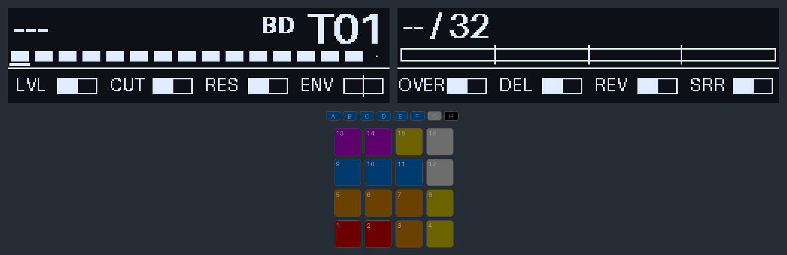

- **Écran gauche, en haut** : pattern en cours (`---` tant que la DT2 n'a
  rien dit) et la track sélectionnée en gros (`BD T01`, code de la grille de
  la doctrine).
- **Bande des mutes** : une case par track, pleine = ouverte, vide =
  mutée ; la track sélectionnée est soulignée ; la 16 n'a qu'un point
  (AUTO CHANNEL, pas de mute).
- **Écran droit, en haut** : mesure dans la phrase (`10 / 32`), tonique et
  mode de la banque, phrase et mesures avant le prochain cap.
- **En bas des deux écrans** : les 8 paramètres des encodeurs de la track
  sélectionnée, une jauge par encodeur. Jauge en pointillé = valeur pas
  encore confirmée par la DT2 (après un changement de pattern).

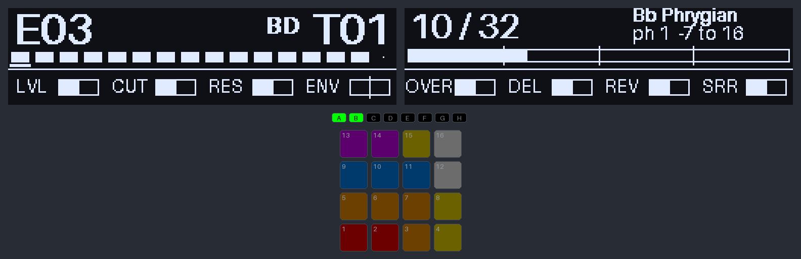

## 3. Jouer le kit : les pads MPC

Au chargement, les 16 pads sont un kit, lu comme sur une MPC (pad 1 en bas
à gauche) :

```
 CR   RD   CH2  OH2      cymbales / variantes    (T6, T5)
 LT   MT   HT   OH       toms, open hat          (T4, T5)
 RS   CP   SD2  CH       rim, clap, snare 2, hat (T4, T3, T5)
 BD   BD2  SD   CH1      kick, kick long, snare  (T1, T3, T5)
```

- Chaque pad envoie **une tranche** (note) sur le **canal de sa track**.
  Les tracks 1, 3, 4, 5 et 6 jouent un sample découpé en tranches (machine
  SLICE, paramètre `SLICE` = `NOTE`).
- **Couleurs** : kicks rouges, snares, clap et rim orange, hats fermés
  jaunes, ouverts blancs, toms bleus, cymbales violettes. Pad plein à la
  frappe.
- **Choke gratuit** : une track ne joue qu'une voix. L'open hat coupe le
  closed hat (T5), le clap coupe la snare (T3), un tom coupe le précédent.
- Vélocité = force de frappe. À la frappe, l'écran gauche affiche le pad,
  la track, la tranche et la vélocité :

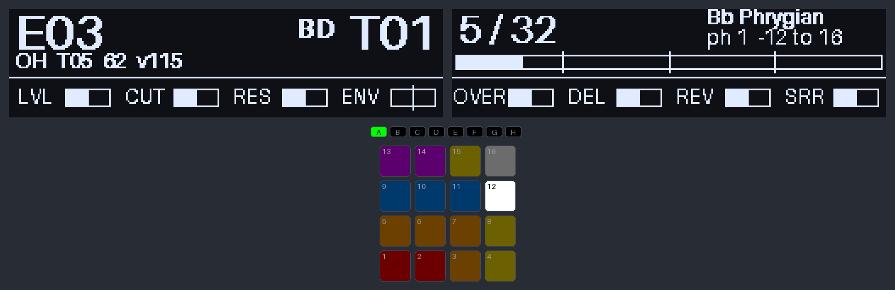

La table est dans `config/default.yaml` (`mpc:`) : track, note, label et
couleur de chaque pad. **À vérifier** : la note qui joue la tranche 1 (60
supposée). Si la DT2 joue autre chose, on corrige les notes de la table.

## 4. Banques et patterns

- **La DT2 mène** : quand elle change de pattern, mk-brain suit. Un
  changement de banque règle la tonique, le mode, la phrase et la
  disposition du clavier, et annonce la banque 2 s :

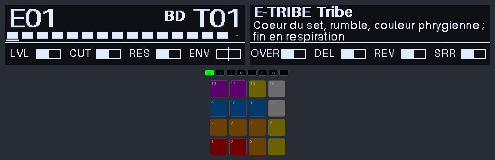

- **GROUP A-H seul** choisit la banque courante sur la MK2, sans rien
  envoyer à la DT2 (couleurs du clavier, phrase, banque de PATTERN + pad).
  Si la DT2 reste dans sa banque, ce choix tient ; s'il change de banque,
  elle reprend la main.
- **PATTERN + pad n** : pattern n de la banque courante, mis en file par la
  DT2 comme ses propres changements. Sans banque connue : `bank? (GROUP)`.
- **LED GROUP** : transport lancé, le compteur de phrases ; arrêté, les
  banques du projet, la courante en blanc.

## 5. Compteur de phrases

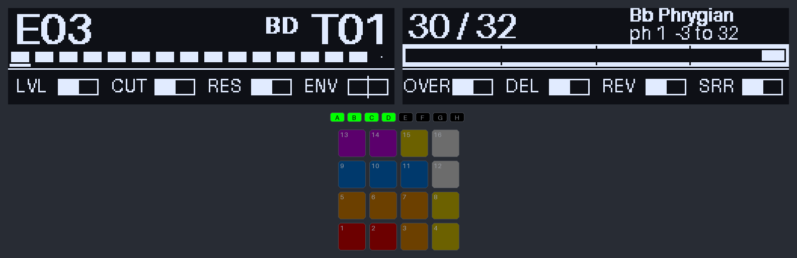

- Mesure 1 au Start de la DT2 et à chaque changement de pattern (à la barre
  suivante). Une LED GROUP de plus toutes les 8 mesures ; PLAY pulse sur le 1.
- Les 4 dernières mesures d'une phrase s'inversent ; `-2`, `-1` en grand
  avant le cap.
- **SHIFT + PLAY** : mesure 1 à la barre suivante. **SHIFT + GROUP n** :
  recale au début du bloc n (n × 8 − 7).
- Longueur 32 ou 64 : celle de la banque, ou le menu PHRASE.

## 6. Encodeurs et tracks

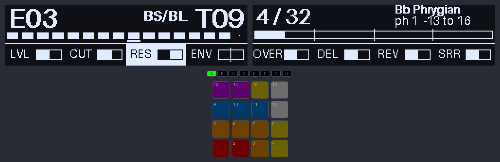

- **SELECT + pad n** : track n pour les 8 encodeurs (et pour le clavier).
  **SELECT + pad 16** : la track active de la DT2. Tourner un bouton sur la
  DT2 sélectionne aussi sa track sur la MK2.
- Pendant SELECT ou MUTE tenus, les pads montrent la grille des 16 tracks
  (pad n = track n), pas le kit. Pendant PATTERN tenu, seul le pad du
  pattern en cours est allumé.
- **Flèches BROWSE ◀ ▶** : page 1 (LVL CUT RES ENV / OVER DEL REV SRR) ou
  page 2 (LVL MW BC PB / BR CHO TUNE PAN), en boucle.
- **PB** (pitch bend) seulement SHIFT tenu ; il revient au centre au
  relâché de SHIFT.

## 7. Mutes

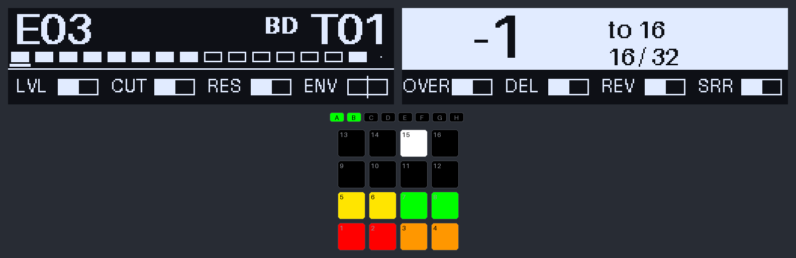

**MUTE + pad n** mute ou rouvre la track n. MUTE tenu, les pads montrent
les tracks ouvertes en couleur, les mutées éteintes. Les mutes joués sur la
DT2 s'affichent aussi.

## 8. Quantize, swing, note repeat

- **GRID** : quantize off → 1/16 → 1/8 (LED allumée si active). Une frappe
  juste après un pas part tout de suite, une frappe en avance attend le pas.
- **SWING + encodeur maître** : 50 à 75 %, à caler à la main sur la DT2.
- **NOTE REPEAT tenu + pad** : répétition calée sur l'horloge, vélocité =
  pression du doigt. Les 8 boutons au-dessus des écrans choisissent la
  division. **SHIFT + NOTE REPEAT** verrouille le repeat.

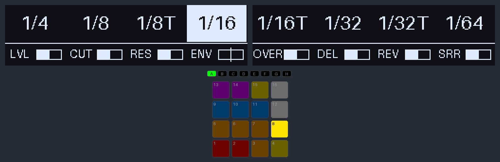

## 9. Le clavier (PAD MODE)

**PAD MODE** bascule les pads entre le kit MPC et un clavier joué sur la
**track sélectionnée** (LED PAD MODE pleine en clavier). L'écran gauche
passe en vue détaillée, encadrée, icône `K`.

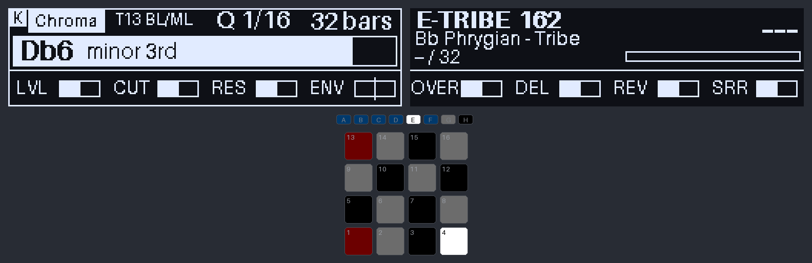

- La disposition suit le mode de la banque (éolien → Aeolian, phrygien →
  Phrygian…) et part de sa tonique.
- **Chroma** : 16 demi-tons, tonique rouge, notes de la gamme allumées,
  hors gamme éteintes mais jouables. À la frappe : la note et son degré.
- **Gammes** : seules les notes du mode, tonique rouge, tierce jaune,
  quinte verte.

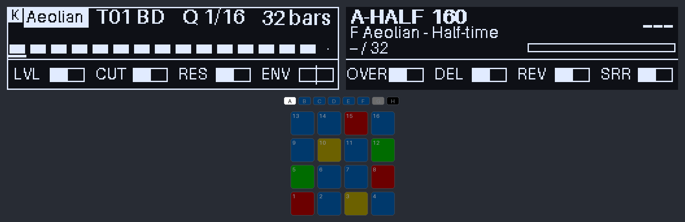

- **Flèches de transport ◀ ▶** : octave −1 / +1, ±4 au plus.
- **Menu**, boutons d'écran 1-4 : GAMME (disposition), TRACK, QUANT,
  PHRASE. Une entrée a toujours le focus (GAMME au départ) : l'encodeur
  maître règle sa valeur tout de suite, en boucle ; son appui passe le
  focus à l'entrée suivante, un bouton d'écran le donne à la sienne. GAMME
  propose aussi, après les sept dispositions, des gammes exotiques
  (Locrian, Hung. min, Dbl harm., Blues, Hirajoshi, In-sen, Pelog, Whole
  tone) ; son choix tient jusqu'au prochain changement de banque.

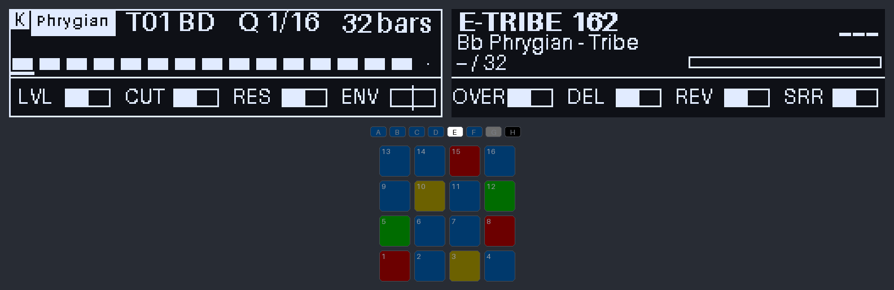

## 10. Enregistrer sur la DT2

1. **GRID → off** : la DT2 quantize l'enregistrement elle-même.
2. Sur la DT2 : `[RECORD] + [PLAY]` (LIVE REC).
3. Jouer : clavier sur la track sélectionnée, encodeurs en p-locks.

**À vérifier** (sonde `scripts/dt2_mpc_probe.py`, SPEC questions 16-17) :
les notes envoyées sur le canal d'une track qui n'est pas la track active
s'enregistrent-elles ? Et la tranche jouée en MPC ? En attendant, le plus
sûr est d'enregistrer sur la track active de la DT2 (SELECT + pad 16).

## 11. Aide-mémoire

| Geste | Effet |
|---|---|
| Pad | kit MPC, ou clavier sur la track sélectionnée |
| PAD MODE | MPC ↔ clavier |
| GROUP A-H | banque courante (sans envoi) |
| SELECT + pad | track des encodeurs et du clavier (16 = track active DT2) |
| MUTE + pad | mute / ouvre la track |
| PATTERN + pad | pattern n de la banque courante |
| BROWSE ◀ ▶ | page d'encodeurs |
| SHIFT + BROWSE | sélection de projet (transport arrêté) |
| Flèches de transport | octave du clavier |
| GRID | quantize off / 1/16 / 1/8 |
| SWING + maître | swing |
| NOTE REPEAT (+ SHIFT) | repeat tenu (verrouillé) ; boutons d'écran = division |
| Boutons d'écran 1-4 | focus du menu GAMME, TRACK, QUANT, PHRASE |
| Encodeur maître | valeur de l'entrée au focus ; appui = entrée suivante |
| SHIFT + PLAY | phrase à 1 à la barre suivante |
| SHIFT + GROUP n | recalage au bloc n |

PLAY et REC de la MK2 n'envoient ni Start ni Stop : la DT2 reste maître du
transport. Les boutons sans rôle ont leur LED éteinte.
