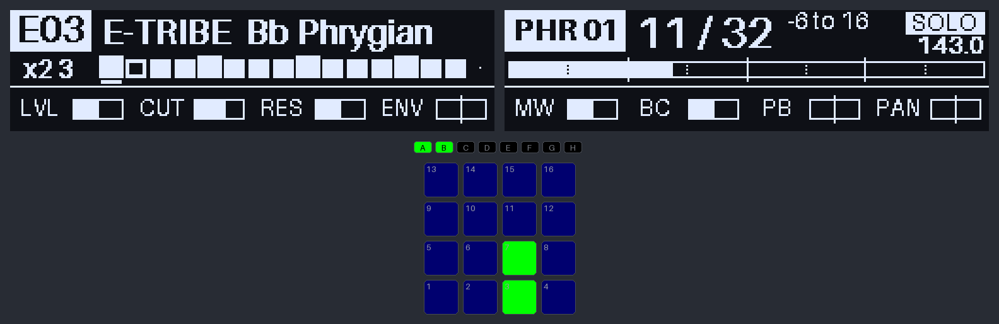
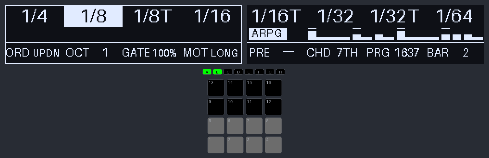

# Guide utilisateur — mk-brain

La Maschine MK2 joue la Digitakt II sans Mac ni logiciel Native Instruments :
pads, encodeurs et écrans pilotés par mk-brain, la DT2 garde l'horloge et le
transport. Ce guide décrit la v0.21.0 (mode unique, pads MPC). La spec fait
foi pour le détail : [SPEC.md](../SPEC.md).

Les captures sont rendues par le code de l'appareil (`docs/screens.py`),
écrans en haut, LED GROUP A-H et pads en dessous. Les LED au repos y sont
éclaircies pour rester lisibles.

## 1. Avant de jouer

**Branchements** : MK2 en USB directement sur le Mac (pas sur un hub non
alimenté, elle n'y apparaît pas), DT2 en USB. Elektron Transfer fermé.

**Réglages DT2** (une fois) :

| Menu | Réglage |
|---|---|
| USB CONFIG | USB MIDI |
| PORT CONFIG | INPUT FROM et OUTPUT TO = USB ; OUTPUT CH = TRACK CH ; ENCODER DEST et MUTE DEST = INT + EXT |
| SYNC | CLOCK SEND, TRANSPORT SEND, PRG CH SEND, PRG CH RECEIVE = on |
| CHANNELS | TRACK n CHANNEL = n ; AUTO CHANNEL = 16 ; PROGRAM CHG IN CH et OUT CH = 10 |

**Lancer** :

```bash
cd mk-brain && .venv/bin/mk-brain play
```


L'encodeur maître fait défiler les projets, son appui charge. Le dernier
joué est présélectionné : un appui suffit. SHIFT + BROWSE (◀ ou ▶) revient
à cette liste, transport arrêté seulement.

## 2. Lire les écrans


- **Écran gauche, coin gauche** : comme sur la DT2, le pattern en cours en
  noir sur blanc (`E03`, `---` tant que la DT2 n'a rien dit) et, dessous,
  la track sélectionnée (`TR 1`).
- **Écran gauche, en haut** : la banque et sa tonalité (`E-TRIBE  Bb
  Phrygian`), remplacées un instant par une alerte, le dernier geste ou la
  frappe d'un pad.
- **Bande des mutes** : une case par track, pleine = ouverte, vide =
  mutée ; la track sélectionnée est soulignée ; la 16 n'a qu'un point
  (AUTO CHANNEL, pas de mute). Transport lancé, un petit carré parcourt
  les 16 cases : c'est la double croche en cours dans la mesure. Un
  fin pointillé vertical sépare les temps, entre les cases 4/5, 8/9 et
  12/13.
- **Écran droit, en haut** : la phrase en noir sur blanc (`PHR 01`), la
  mesure dans la phrase (`10 / 32`), les mesures avant le prochain cap
  (`-7 to 16`) et, dessous, le pattern suivant quand il est annoncé
  (`> E04`) ; à droite le mode des pads (`MPC`, `KEYS`, `SOLO`) et, dessous,
  le tempo de la clock, lissé sur une mesure.
- **Barre de la phrase** : une case par mesure, un trait tous les 8
  mesures, un pointillé à chaque tour de pattern (4 mesures).
- **En bas des deux écrans** : les 8 paramètres des encodeurs de la track
  sélectionnée, une jauge par encodeur. Jauge en pointillé = valeur pas
  encore confirmée par la DT2 (après un changement de pattern).


## 3. Jouer le kit : les pads MPC

Au chargement, les 16 pads sont un kit, lu comme sur une MPC (pad 1 en bas
à gauche) :

```
 CR   RD   CH2  OH2      cymbales / variantes    (T6, T5)
 LT   MT   HT   OH       toms, open hat          (T4, T5)
 RS   CP   SD2  CH       rim, clap, snare 2, hat (T4, T3, T5)
 BD   BD2  SD   CH1      kick, kick long, snare  (T1, T3, T5)
```

- Chaque pad envoie **une tranche** (note) sur le **canal de sa track**.
  Les tracks 1, 3, 4, 5 et 6 jouent un sample découpé en tranches (machine
  SLICE, paramètre `SLICE` = `NOTE`).
- **Couleurs** : kicks rouges, snares, clap et rim orange, hats fermés
  jaunes, ouverts blancs, toms bleus, cymbales violettes. Pad plein à la
  frappe.
- **Choke gratuit** : une track ne joue qu'une voix. L'open hat coupe le
  closed hat (T5), le clap coupe la snare (T3), un tom coupe le précédent.
- **Aftertouch** : tenir un pad et appuyer plus fort module sa track
  (aftertouch de canal), si le preset de la DT2 lui assigne un paramètre.
  La frappe seule n'en envoie pas ; au clavier, le pad le plus appuyé
  l'emporte.
- Vélocité = force de frappe. À la frappe, l'écran gauche affiche le pad,
  la track, la tranche et la vélocité :


La table est dans `config/default.yaml` (`mpc:`) : track, note, label et
couleur de chaque pad. **À vérifier** : la note qui joue la tranche 1 (60
supposée). Si la DT2 joue autre chose, on corrige les notes de la table.

## 4. Banques et patterns

- **La DT2 mène** : quand elle change de pattern, mk-brain suit. Un
  changement de banque règle la tonique, le mode, la phrase et la
  disposition du clavier, et annonce la banque 2 s :


- **GROUP A-H seul** choisit la banque courante sur la MK2, sans rien
  envoyer à la DT2 (couleurs du clavier, phrase).
  Si la DT2 reste dans sa banque, ce choix tient ; s'il change de banque,
  elle reprend la main.
- **Les patterns se changent sur la DT2 seulement** : PATTERN n'a pas de
  rôle sur la MK2.
- **LED GROUP** : transport lancé, le compteur de phrases ; arrêté, la
  banque courante seule, en blanc.

## 5. Compteur de phrases


- Mesure 1 au Start de la DT2 et à chaque changement de pattern (à la barre
  suivante). Une LED GROUP de plus toutes les 8 mesures : celle du bloc en cours
  clignote au temps, en vert, puis en orange la dernière mesure avant un cap.
  PLAY clignote au tempo.
- Les 4 dernières mesures d'une phrase s'inversent ; `-2`, `-1` en grand
  avant le cap.
- **SHIFT + PLAY** : mesure 1 à la barre suivante. **SHIFT + GROUP n** :
  recale au début du bloc n (n × 8 − 7).
- Longueur 32 ou 64 : celle de la banque, ou le menu PHRASE.

## 6. Encodeurs et tracks


- **SELECT + pad n** : track n pour les 8 encodeurs (et pour le clavier).
  **SELECT + pad 16** : la track active de la DT2. Tourner un bouton sur la
  DT2 sélectionne aussi sa track sur la MK2.
- Pendant SELECT ou MUTE tenus, les pads montrent la grille des 16 tracks
  (pad n = track n), pas le kit ; sous SELECT, seul le pad de la track
  sélectionnée est allumé. L'étiquette de mode affiche `MUTE` ou `SELECT`.
- **SHIFT + encodeur** : réglage temporaire. Tout ce qui est tourné SHIFT
  tenu revient à sa valeur d'avant au relâché, sur plusieurs encodeurs à la
  fois et, en SOLO, sur toutes les tracks du groupe.
- **Flèches BROWSE ◀ ▶** : page 1 (LVL BR OVER SRR / DEL REV CHO TUNE) ou
  page 2 (LVL CUT RES ENV / MW BC PB PAN), en boucle.
- **PB** (pitch bend) seulement SHIFT tenu ; il revient au centre au
  relâché de SHIFT. Marche aussi en SOLO, sur toutes les tracks du groupe.

### Perform : SOLO



- **SOLO** (LED pleine) : les pads ne jouent plus, pad n = track n, que
  les pads soient en MPC ou en clavier. Pads en bleu très faible, ceux du
  groupe en vert vif.
- Un tap sur un pad ajoute sa track au groupe, un second tap la retire.
  Les encodeurs règlent toutes les tracks du groupe, sans rien tenir ; les
  valeurs restent. Groupe vide : la track sélectionnée.
- L'écran montre la première track du groupe et ses faders (`x2 3` s'il y en
  a deux, la première étant la 3).
- **SOLO** à nouveau ou **PAD MODE** : sortie, groupe vidé, les pads
  rejouent (PAD MODE ne change pas la disposition en sortant de SOLO).

## 7. Mutes


**MUTE + pad n** mute ou rouvre la track n. MUTE tenu, les pads montrent
les tracks ouvertes en couleur, les mutées éteintes. Les mutes joués sur la
DT2 s'affichent aussi.

## 8. Quantize, swing, note repeat

- **GRID** : quantize off → 1/16 → 1/8 (LED allumée si active). Une frappe
  juste après un pas part tout de suite, une frappe en avance attend le pas.
- **SWING + encodeur maître** : 50 à 75 %, à caler à la main sur la DT2.
- **NOTE REPEAT tenu + pad** : répétition calée sur l'horloge, vélocité =
  pression du doigt. Les 8 boutons au-dessus des écrans choisissent la
  division. **SHIFT + NOTE REPEAT** verrouille le repeat.


## 9. Le clavier (PAD MODE)

**PAD MODE** bascule les pads entre le kit MPC et un clavier joué sur la
**track sélectionnée** (LED PAD MODE pleine en clavier). Les écrans
restent ceux du MPC, encadrés ; une frappe montre sa note et son degré
à la place de la banque, l'octave décalée s'affiche à droite (`oct +1`).


- La disposition suit le mode de la banque (éolien → Aeolian, phrygien →
  Phrygian…) et part de sa tonique.
- **Chroma** : 16 demi-tons, tonique rouge, notes de la gamme allumées,
  hors gamme éteintes mais jouables. À la frappe : la note et son degré.
- **Gammes** : seules les notes du mode, tonique rouge, tierce jaune,
  quinte verte.


- **Flèches de transport ◀ ▶** : octave −1 / +1, ±4 au plus.
- **Menu**, boutons d'écran 1-4 : GAMME (disposition), TRACK, QUANT,
  PHRASE. Une entrée a toujours le focus (GAMME au départ) : l'encodeur
  maître règle sa valeur tout de suite, en boucle ; son appui passe le
  focus à l'entrée suivante, un bouton d'écran le donne à la sienne. GAMME
  propose aussi, après les sept dispositions, des gammes exotiques
  (Locrian, Hung. min, Dbl harm., Blues, Hirajoshi, In-sen, Pelog, Whole
  tone) ; son choix tient jusqu'au prochain changement de banque. Le menu
  n'a plus de bandeau : l'entrée choisie et sa valeur passent 1,5 s dans
  le bandeau gauche.

## 10. L'arpégiateur (PATTERN)

**PATTERN** ouvre le mode `ARPG` : le clavier de la track sélectionnée,
mais les pads tenus ne sonnent plus en accord, ils sont joués un par un,
une note par division, calés sur l'horloge de la DT2. Transport arrêté, il
n'y a pas d'arpège : les pads jouent comme au clavier.



- **PATTERN tenu** : la config de l'arpège, ci-dessus. Les encodeurs 1-3
  règlent `ORD` (UP montant, DOWN descendant, UPDN aller-retour, PLAY
  ordre d'appui, RAND aléatoire), `OCT` (1 à 3 octaves) et `GATE` (durée
  de chaque note, 10 à 100 % de la division). Relâché, les écrans
  principaux reviennent (pattern, mutes, compteur) et les encodeurs
  règlent de nouveau la track, pendant que l'arpège joue.
- **Encodeur 4, PATTERN tenu** : `MOT`, le motif rythmique. `OFF` joue une
  note par division ; les autres (`GALO`, `OFFB`, `TRES`, `A332`, `SYNC`,
  `ROLL`, `LONG`, `ACID`) posent l'arpège sur 16 pas, dessinés sur l'écran
  droit : colonne pleine = note accentuée, demi-colonne = note plus
  douce, point = silence, trait = la note précédente dure un pas de plus.
  Sur un silence la note attend : toutes les notes tenues sonnent. En
  1/16 le motif fait une mesure, calé sur celle de la DT2. Les motifs
  s'écrivent dans `arp.motifs` de `config/default.yaml`.
- **Encodeur 5, PATTERN tenu** : `PRE`, les presets. Chacun rappelle d'un
  coup ordre, octaves, gate, division et motif, dès qu'il est affiché
  (`ACD1`, `GAL2`, `TRIB`, `CTPS`, `RUSH`, `NAPP`, `HASD`, `TRIO`). C'est
  un point de départ : tout se retouche ensuite, et `PRE` affiche alors
  `----` ; l'encodeur repart du dernier preset rappelé. `----`, en début
  de liste, ne change rien.
- **Encodeur 6, PATTERN tenu** : `CHD`, les accords. `OFF` : chaque pad
  tenu apporte sa note. Sinon un pad = un accord, pris dans la gamme de
  la banque, et l'arpège en joue les notes : `TRI` (1-3-5), `7TH`
  (1-3-5-7), `SUS2` (1-2-5), `SUS4` (1-4-5), `PWR` (1-5-8). En la# éolien,
  `TRI` sur le pad la# joue la# réb fa, sur le pad réb : réb fa lab. Un
  doigt suffit ; plusieurs pads tenus ajoutent leurs accords. Se combine
  avec le motif, et se garde dans les presets.
- **Encodeurs 7 et 8, PATTERN tenu** : `PRG`, la progression d'accords,
  et `BAR`, la durée de chaque accord (`1/2`, `1`, `2` ou `4` mesures).
  `PRG OFF` : rien ne bouge. Sinon le pad tenu suit une suite de degrés
  dans la gamme de la banque, tout seul, calé sur le transport : `1637`
  sur le pad de la tonique en éolien joue i, VI, III, VII, un accord par
  durée `BAR`, en boucle. Le degré 1 est la note du pad : un autre pad
  décale toute la suite. Les degrés 5 à 7 passent sous le pad. Avec `CHD
  OFF` c'est la note seule qui se déplace (ligne de basse). Les
  progressions s'écrivent dans `arp.progressions` de
  `config/default.yaml` (`1637`, `1765`, `1645`, `1474`, `1516`, `1716`).
- **Pads, PATTERN tenu** : la banque des 16 presets, un par pad. Un pad
  rappelle son preset ; **SHIFT + pad** y écrit les réglages courants
  (ordre, octaves, gate, division, motif, accord, progression et sa
  durée), sans confirmation, sous le nom
  `U` + numéro du pad (`U03`). Pad faiblement allumé : emplacement
  occupé ; plein : le preset courant ; éteint : vide. Pendant l'appui les
  pads ne jouent pas : pour changer de preset en jouant, garder l'arpège
  avec le maintien (NOTE REPEAT). Les presets sauvés sont gardés sur la
  machine (`state/arp-presets.json`), communs à tous les projets ; ceux de
  `arp.presets` de `config/default.yaml` remplissent les pads 1 à 8 tant
  qu'on n'a rien sauvé dessus.
- **Boutons d'écran 1-8** : la division (1/4 à 1/64), comme le note
  repeat, PATTERN tenu ou non.
- **Pression** : appuyer plus fort sur un pad accentue sa note.
- **NOTE REPEAT** : maintien (LED allumée). L'arpège continue pads
  relâchés ; frapper un pad alors qu'aucun n'est tenu remplace les notes,
  en frapper un pendant qu'un autre est tenu l'ajoute. Pour un nouvel
  accord, poser les pads et les tenir un instant avant de relâcher.
- **Sortir** : un appui bref sur PATTERN revient au clavier, PAD MODE au
  kit MPC ; l'arpège et son maintien s'arrêtent.

La DT2 reçoit des notes ordinaires : en LIVE REC, l'arpège s'enregistre
dans le pattern de la track.

## 11. Enregistrer sur la DT2

1. **GRID → off** : la DT2 quantize l'enregistrement elle-même.
2. Sur la DT2 : `[RECORD] + [PLAY]` (LIVE REC).
3. Jouer : clavier sur la track sélectionnée, encodeurs en p-locks.

**À vérifier** (sonde `scripts/dt2_mpc_probe.py`, SPEC questions 16-17) :
les notes envoyées sur le canal d'une track qui n'est pas la track active
s'enregistrent-elles ? Et la tranche jouée en MPC ? En attendant, le plus
sûr est d'enregistrer sur la track active de la DT2 (SELECT + pad 16).

## 12. Aide-mémoire

| Geste | Effet |
|---|---|
| Pad | kit MPC, ou clavier sur la track sélectionnée |
| PAD MODE | MPC ↔ clavier ; sous SOLO : sortie de SOLO |
| GROUP A-H | banque courante (sans envoi) |
| SELECT + pad | track des encodeurs et du clavier (16 = track active DT2) |
| MUTE + pad | mute / ouvre la track |
| SOLO | perform verrouillé : tap sur pad n = ajoute / retire la track n |
| SHIFT + encodeur | réglage temporaire, rendu au relâché de SHIFT (PB : au centre) |
| BROWSE ◀ ▶ | page d'encodeurs |
| SHIFT + BROWSE | sélection de projet (transport arrêté) |
| Flèches de transport | octave du clavier |
| GRID | quantize off / 1/16 / 1/8 |
| SWING + maître | swing |
| NOTE REPEAT (+ SHIFT) | repeat tenu (verrouillé) ; boutons d'écran = division |
| PATTERN | appui bref : mode ARPG ↔ clavier (pads tenus arpégés) ; tenu en ARPG : config, encodeurs 1-8 = ORD, OCT, GATE, MOT (motif), PRE (preset), CHD (accord), PRG (progression), BAR (durée d'un accord), pad n = preset n, SHIFT + pad n = sauver dans n ; boutons d'écran = division, NOTE REPEAT = maintien |
| Boutons d'écran 1-4 | focus du menu GAMME, TRACK, QUANT, PHRASE |
| Encodeur maître | valeur de l'entrée au focus ; appui = entrée suivante |
| SHIFT + PLAY | phrase à 1 à la barre suivante |
| SHIFT + GROUP n | recalage au bloc n |
| SHIFT + ERASE tenus 2 s | extinction propre du Pi (sur le Pi seulement) ; relâcher avant annule |

PLAY et REC de la MK2 n'envoient ni Start ni Stop : la DT2 reste maître du
transport. Les boutons sans rôle ont leur LED éteinte.
